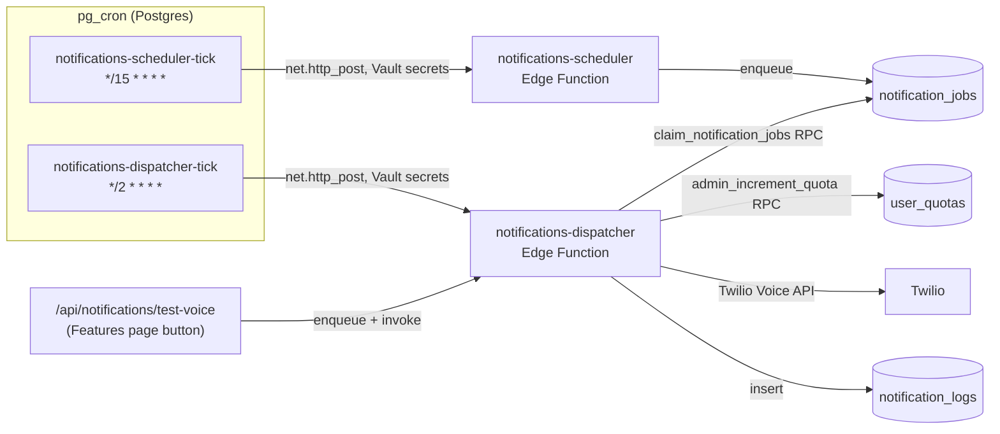

# Notification System

How Cheque Check delivers Voice Reminder calls (and the sample test-call
feature), what user preferences it respects, how the scheduler/dispatcher
pipeline works, and how to troubleshoot it. Covers the Voice channel shipped
today; Email/Push/WhatsApp are planned follow-ups built on the same schema.

## 1. Architecture overview

- **notifications-scheduler** (`supabase/functions/notifications-scheduler/`) runs every 15
  minutes. For every eligible profile, it computes the profile's local time
  (via `time_zone`), checks whether "now" falls in one of that profile's
  reminder slots, finds cheques due for reminding, and enqueues one
  `notification_jobs` row per business.
- **notifications-dispatcher** (`supabase/functions/notifications-dispatcher/`) runs every 2
  minutes. It atomically claims a batch of due jobs, places the Twilio voice
  call, records the outcome, and retries failures with backoff.
- Both are plain Deno Edge Functions with **no shared npm deps** — Twilio is
  called via raw `fetch` (works identically whether deployed via the CLI or
  pasted into the Supabase Dashboard editor, since the Dashboard can't resolve
  cross-function imports from `supabase/functions/_shared/`).
- `pg_cron` calls both functions via `net.http_post`, reading the project URL
  and service-role key from **Supabase Vault** (not hardcoded — see
  `supabase/migrations/20261017000000_notification_platform.sql`).

## 2. Data model

| Table                | Purpose                                                                                                                                                                                             |
| -------------------- | --------------------------------------------------------------------------------------------------------------------------------------------------------------------------------------------------- |
| `notification_jobs`  | The queue. One row per (business, channel, day, slot) for real reminders, or one row per sample test call. `idempotency_key` prevents duplicate enqueues across overlapping scheduler ticks.        |
| `notification_logs`  | Immutable delivery audit trail — one row per dispatch attempt that actually reached a provider (Twilio), with `provider_message_id` (Twilio Call SID) for cross-referencing Twilio's own Call Logs. |
| `push_subscriptions` | Reserved for the future Web Push channel (not wired up yet).                                                                                                                                        |
| `user_quotas`        | Shared with the rest of the monetization system. `feature_id = 'voice_reminder'` is the quota pool both real reminders **and** sample test calls draw from.                                         |

`channel` and `status` are `TEXT` + `CHECK` constraints (not Postgres enums).
`purpose` is **unconstrained** `TEXT` on purpose — see §6.

## 3. User preferences the system respects

On the Features page, Voice Reminder access, the daily-call switch, and phone
setup are separate controls. Users with subscription or trial credits can
configure their phone even while daily calls are off. Phone edits require
**Save phone number**; test calls stay disabled until the saved number is valid,
the service is on, and call credits remain. Switching calls off does not pause
the paid access period. Test calls consume the same quota as scheduled calls.

The page also shows remaining credits, subscription access dates, and eligible
top-ups. **Purchases & activation** lists recent payment orders and their actual
transaction statuses. **Refresh status** reloads payments, entitlements, and
quotas; checkout success alone is not treated as confirmed feature activation.

| Preference              | Column                                                                                                    | Where it's used                                                                                                                                                                      |
| ----------------------- | --------------------------------------------------------------------------------------------------------- | ------------------------------------------------------------------------------------------------------------------------------------------------------------------------------------ |
| Phone number            | `profiles.phone`                                                                                          | Dispatcher refuses to call if null; Scheduler skips the profile entirely if null                                                                                                     |
| Voice Reminders enabled | `profiles.voice_call_enabled`                                                                             | Scheduler only considers profiles with this `= true`                                                                                                                                 |
| Time zone               | `profiles.time_zone`                                                                                      | Scheduler computes the profile's **local** wall-clock time via `Intl.DateTimeFormat` — every user gets reminders at their own 9am/1pm/6pm, not a fixed UTC time                      |
| Reminders per day       | `profiles.reminders_per_day` (1/2/3)                                                                      | Maps to 1, 2, or 3 slot times per day (`REMINDER_SLOTS` in `_shared/notifications.ts`) — repeats the reminder at each slot on the due day until the cheque is marked Cleared/Bounced |
| Voice language          | `profiles.language` (`en`/`hi`)                                                                           | Both the real reminder message and the sample test-call message are generated in the user's language via Twilio's `Polly.Aditi` bilingual voice                                      |
| X-days-before           | `cheques.remind_before_days` (set from `profiles.default_reminder_days` at creation, editable per cheque) | Scheduler computes `daysUntilDue = deposit_date - today`; fires once `0 <= daysUntilDue <= remind_before_days`                                                                       |
| Due date                | `cheques.deposit_date` (falls back to `cheques.cheque_date` if no deposit date set)                       | The countdown target. If `deposit_date` is null, the system falls back to same-day-only on `cheque_date` (no "before" reference exists in that case)                                 |
| Cheque status           | `cheques.status`, `is_draft`                                                                              | Only `status = 'Issued'` and `is_draft = false` cheques are considered — Received (inward) cheques don't need a "fund your account" call                                             |

**Preferences explicitly NOT used by Voice Reminders** (by design): `reduce_motion`,
`received_cheques_enabled`, `party_sms_enabled`, `date_format`, `currency`,
`time_format` — these are UI/other-feature preferences, unrelated to this
channel.

## 4. Scheduler logic in detail

1. Fetch all profiles with `voice_call_enabled=true`, non-null `phone` and
   `time_zone`.
2. For each profile, compute `{date, minutesOfDay}` in their local time zone.
3. Resolve their slot list from `reminders_per_day` (1→`[09:00]`,
   2→`[09:00,17:00]`, 3→`[09:00,13:00,18:00]`) and check if "now" falls within
   a 15-minute window of any slot (the window must be ≥ the cron interval, or
   a slot could be missed entirely).
4. If a slot matches, fetch that user's active cheques and filter to the ones
   due for a reminder (§3's remind_before_days logic).
5. Group due cheques by business, and `upsert` one `notification_jobs` row per
   business with `onConflict: 'idempotency_key', ignoreDuplicates: true` —
   safe to re-run the same tick twice, or have two overlapping invocations.

## 5. Dispatcher logic in detail

1. Call `claim_notification_jobs(p_batch_size)` — an atomic
   `UPDATE ... WHERE status='pending' ... FOR UPDATE SKIP LOCKED` that also
   increments `attempts` and sets `status='processing'`. This is what makes
   it safe to run every 2 minutes without double-sending if a previous
   invocation is still running.
2. For each claimed job:
   - Fetch the profile; skip (no log entry, job marked `skipped`) if no phone.
   - Call `admin_increment_quota(user_id, 'voice_reminder')` — **reserves**
     quota atomically _before_ calling Twilio. If it returns `false` (no
     quota left), the job is marked `skipped` without ever contacting Twilio.
   - Build the voice message (real cheque summary, or the canned sample-test
     message — see §6) in the user's `language`.
   - Call Twilio's Voice API directly via `fetch` (no SDK).
   - On success: mark `sent`, write a `notification_logs` row with the Twilio
     Call SID.
   - On failure: write a `failed` log row, and either reschedule with backoff
     (10min → 30min → 2h, max 3 attempts) or mark `failed` permanently.

## 6. Sample / test-call feature

Users can trigger a real voice call to themselves from the **Features** page
(Voice Reminder add-on card → "Send test call" button), to verify their setup
works before relying on it.

- **Only available** once Voice Reminders is already toggled on and a valid
  phone number is set (same gate as real reminders use) — this intentionally
  prevents testing a configuration that wouldn't actually receive reminders.
- **Counts against the same `voice_reminder` quota** as real reminders — no
  separate "test" allowance.
- **Rate-limited** to 1 request per 5 minutes per user (reuses the existing
  `consume_api_rate_limit` RPC, same mechanism as the payment-order endpoint)
  to prevent accidental double-click spam burning quota/Twilio cost.
- **Dispatched synchronously**: `POST /api/notifications/test-voice`
  (`src/app/api/notifications/test-voice/route.ts`) enqueues a
  `notification_jobs` row with `purpose: 'sample_voice_test'` and a random
  (never-colliding) `idempotency_key`, then immediately invokes the deployed
  `notifications-dispatcher` function and reads back the job's final status —
  the user gets a real pass/fail result in the UI within a few seconds instead
  of waiting for the next cron tick.
- The dispatcher recognizes `purpose === 'sample_voice_test'` and builds a
  **canned test message** ("Hello {name}, this is a test call from Cheque
  Check...") instead of fetching real cheques — see
  `DispatcherOrchestrator.buildSampleMessage()`.

## 7. Hardcoded-value audit (what can safely change vs. what can't)

**Already dynamic / DB-driven (safe to change via the dashboard or
`payment_products` table without a code deploy):** product pricing, which
products are `active`, `entitlement_days`, `quota_increment` — the
`/api/payments/create-order` route reads all of these from the
`payment_products` table at request time.

**Found hardcoded as raw string literals in 5+ independent places** (the
exact concern this review was asked to check): `voice_reminder`,
`voice_reminder_sub`, `voice_reminder_30d`, `voice_reminder_100`, and their
`ai_scan`/`lifetime_premium` siblings were separately retyped in
`src/app/(dashboard)/features/page.tsx`, `src/lib/payments.ts`,
`src/features/monetization/lib/payment-product-icons.ts`, and
`scripts/admin-monetization.ts` (each with its **own** duplicated
`FeatureType`/product-id list). A future rename in one place without updating
the others would fail silently (e.g. a Razorpay button calling a `productId`
that no longer exists in `payment_products`).

**Fix applied**: `src/features/monetization/constants.ts` is now the single
source of truth (`FEATURE_IDS`, `PRODUCT_IDS`, `ENTITLEMENT_STATUS` +
derived arrays/zod schema), imported by all of the above. The Postgres enum
values themselves (`feature_type`, `entitlement_status`) still require a
migration to change — that's unavoidable — but the _application-layer_
duplication is gone. The Deno edge functions (which can't import from `src/`)
have their own minimal mirror: `supabase/functions/_shared/feature-ids.ts`
(just the one value they need, `voice_reminder`), with a comment pointing
back to the canonical source.

**Intentionally NOT made dynamic**: `notification_jobs.channel`/`status` and
`purpose` use `TEXT` (not a Postgres enum) specifically so new values (e.g. a
future `whatsapp` channel, or a new `purpose` like `payment_receipt`) don't
require a migration — see the comment in
`20261017000000_notification_platform.sql`. `channel`/`status` still have a
`CHECK` constraint (small, stable sets); `purpose` has none (validated at the
app layer only).

## 8. Required secrets / configuration

| Secret                                                            | Where                                                 | Purpose                                                                                                                                                            |
| ----------------------------------------------------------------- | ----------------------------------------------------- | ------------------------------------------------------------------------------------------------------------------------------------------------------------------ |
| `TWILIO_ACCOUNT_SID` / `TWILIO_AUTH_TOKEN` / `TWILIO_FROM_NUMBER` | Edge Function secrets                                 | Twilio API credentials + caller ID                                                                                                                                 |
| `NOTIFICATIONS_TEST_MODE` / `NOTIFICATIONS_TEST_PHONE`            | Edge Function secrets                                 | When `true`, **every** outbound voice call (including real reminders!) is redirected to `NOTIFICATIONS_TEST_PHONE`. Turn off before relying on real user delivery. |
| `NOTIFICATIONS_FORCE_RUN`                                         | Edge Function secret (scheduler only)                 | Testing-only: bypasses the slot-time window so a manual test run doesn't have to wait for 09:00/13:00/18:00 local time. Leave unset/`false` in normal operation.   |
| Vault secret `project_url`                                        | `select vault.create_secret(url, 'project_url')`      | Lets `pg_cron` build the function URL without hardcoding it in a migration                                                                                         |
| Vault secret `service_role_key`                                   | `select vault.create_secret(key, 'service_role_key')` | Lets `pg_cron` authenticate to the functions. **Must be run manually, once** — never commit a service-role key to a migration file.                                |
| `SUPABASE_URL` / `SUPABASE_SERVICE_ROLE_KEY`                      | Auto-injected into every Edge Function                | **Do not** set these manually as custom secrets — Supabase rejects any secret name starting with `SUPABASE_`.                                                      |

## 9. Troubleshooting

**"Account not authorized to call +91... enable international permissions"**
Twilio disables most countries for outbound voice by default on new
accounts. Enable the destination country under Twilio Console → Voice →
Geographic Permissions (Low-Risk **and** High-Risk tabs).

**Dispatcher returns `processed: 0` right after a failure**
Expected — a failed job is rescheduled with backoff (10/30/120 min based on
attempt count) via `markFailedOrRetry`. Check
`select scheduled_at, status, attempts, last_error from notification_jobs order by created_at desc limit 5;`
— if `scheduled_at` is in the future, the dispatcher correctly won't claim it
yet. To force an immediate retry while testing:
`update notification_jobs set scheduled_at = now(), status = 'pending' where id = '...';`

**`401 Unauthorized` calling the edge function manually**
The function's own code compares the incoming `Authorization: Bearer <key>`
against `Deno.env.get('SUPABASE_SERVICE_ROLE_KEY')`. Supabase now has two key
systems — **legacy JWT** (`eyJ...`) and **new** (`sb_secret_...`). Whichever
one is actually auto-injected as `SUPABASE_SERVICE_ROLE_KEY` for your project
is the one your caller (e.g. `.env.local` used by
`scripts/notifications-test.ts`) must also use. Check both Settings → API
Keys sections if one doesn't work.

**A cheque isn't getting reminded even though it looks "due"**
Walk through §3 in order — the most common misses are: `voice_call_enabled`
false, `phone` null, `time_zone` null, or `remind_before_days` null on the
cheque (no offset configured means no reminder window). Also remember: the
Voice Reminder toggle + phone field only render on the **Features** page once
the user has an **active `voice_reminder_sub` entitlement** — a user with
quota but no subscription entitlement will never see the controls to enable
it (this is an intentional monetization gate, not a bug).

**Testing on a corporate/locked-down network**
If the Supabase CLI can't reach `api.supabase.com` (device-login
"Transport error", or `supabase link` failing), everything in this document
can still be done entirely through the Supabase Dashboard SQL Editor and
Edge Functions editor — no CLI required. The one caveat: the Dashboard's
function editor has **no version control**, so always mirror any dashboard
edit back into `supabase/functions/notifications-*` in this repo so the two
don't drift.

**Windows: `spawnSync npx.cmd EINVAL` running `npm run supabase:setup`**
A Node-on-Windows bug spawning `.cmd` shims. Fixed in this repo by invoking
the Supabase CLI's resolved JS entry point via `node` directly (see
`scripts/supabase-setup.ts`, `scripts/supabase-reset.ts`,
`scripts/run-e2e-qa.ts`).

## 10. Extending to new channels (Email / Push / WhatsApp)

The schema was deliberately built generic (`channel` + `purpose` + `payload`
JSONB) so adding a channel means: (1) add the new value to the `channel`
`CHECK` constraint, (2) add a case in `DispatcherOrchestrator.dispatch()`,
(3) add a provider call (SendGrid REST API for email, Web Push for push,
Twilio Messages API with an approved template for WhatsApp) following the
same raw-`fetch`, no-SDK pattern as `TwilioVoiceService`. No schema migration
is needed for a new `purpose` value since it's unconstrained `TEXT`.
